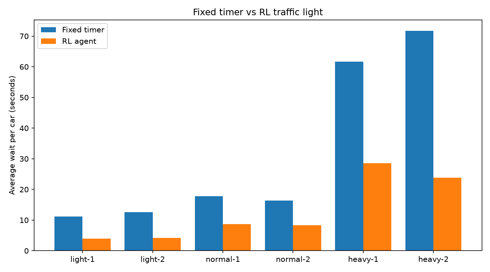

# Smart Traffic Light with Reinforcement Learning

A reinforcement learning agent that controls a traffic light in a simulated city and cuts the average waiting time of cars by about half compared to a normal fixed-timer light.

## The problem

Most traffic lights run on a fixed timer: green for a set time, then red, repeat. They do not react to how many cars are actually waiting, so cars often sit at a red light on an empty road, or queues build up on a busy one.

## The idea in plain words

I built a small virtual city and taught a program to control the light by trial and error. The program looks at the traffic, picks what the light should do, gets a score (fewer waiting cars is better), and slowly learns which choices work best. This is called reinforcement learning.

## How it works

- **Simulator:** SUMO, a free traffic simulation program, controlled from Python.
- **City:** a 3x3 grid of junctions. The middle junction has the smart light. The other eight use normal fixed timers.
- **Agent:** a DQN (Deep Q-Network) from Stable-Baselines3, connected to SUMO through the sumo-rl library.
- **State:** what the agent sees (cars waiting on each road, current light phase).
- **Action:** which light phase to run next.
- **Reward:** the change in total waiting time, so less waiting gives a better score.
- **Training:** 20,000 steps on normal traffic (one new car every 2 seconds).

## Results

Average waiting time per car, fixed timer vs trained agent, on traffic patterns the agent was not trained on:

| Scenario | Fixed timer | RL agent | Improvement |
|---|---|---|---|
| normal-1 | 17.8 s | 8.7 s | 51% |
| normal-2 | 16.4 s | 8.3 s | 49% |
| heavy-1 | 61.7 s | 28.5 s | 54% |
| heavy-2 | 71.7 s | 23.8 s | 67% |

(light-1 and light-2 are in the chart. Add their numbers here from the console output.)

The RL agent won in all six scenarios, and the gap grew as traffic got heavier.

## Limitations

- Only one junction out of nine is controlled by the agent.
- Trained on one traffic pattern with a short training run (20,000 steps).
- Average wait counts only cars that finished their trip. In heavy traffic many cars were still on the road at the end, so those numbers flatter both methods.
- Simulated traffic with random trips, not real Delhi traffic data.

## Next steps

- Train longer and on mixed traffic levels.
- Control all nine junctions with multiple agents.
- Use a real road map of a Delhi area from OpenStreetMap.

## How to run

1. Install SUMO and set `SUMO_HOME`.
2. `pip install traci sumolib numpy pandas matplotlib sumo-rl stable-baselines3`
3. `python train.py` to train the agent.
4. `python compare.py` to test it against the fixed timer and make the chart.
5. `python watch_rl.py` to watch the agent in the SUMO window.